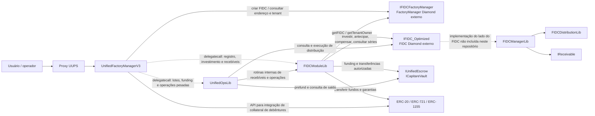
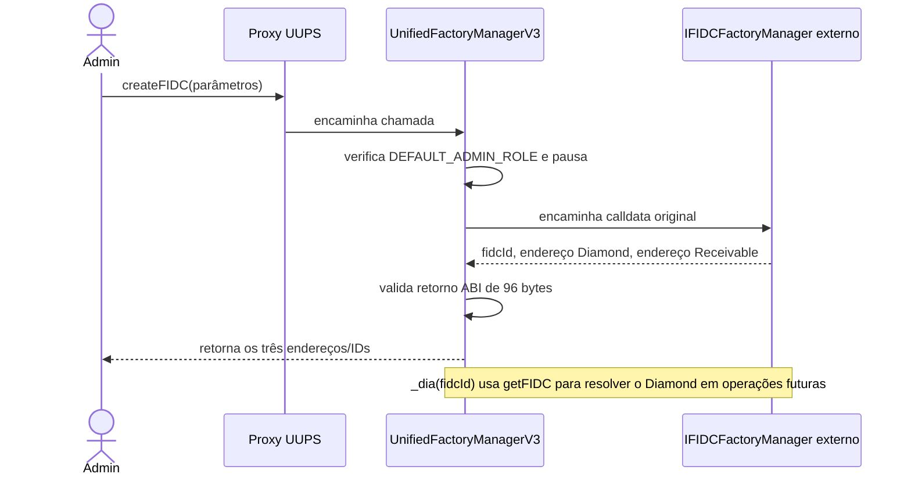
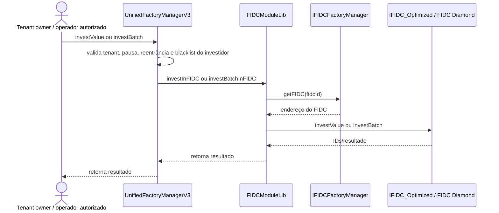
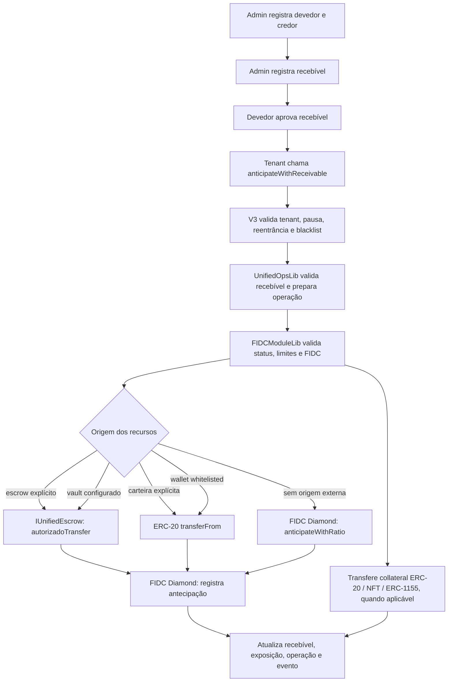
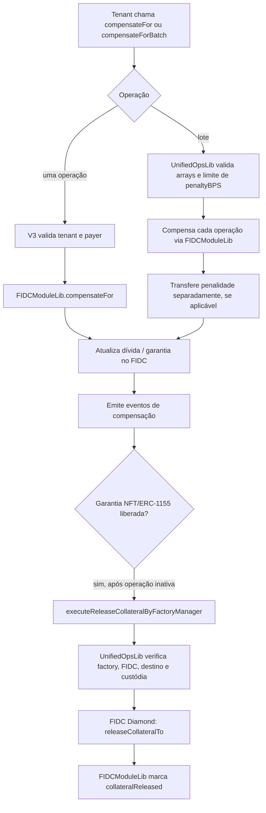
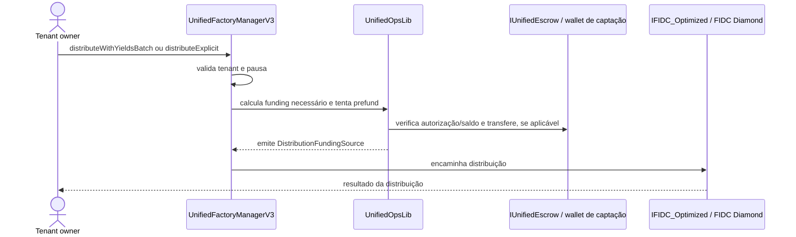

# FIDC Chainlink

Projeto Solidity/Foundry para um gateway unificado de operações FIDC. O gateway V3 é atualizável por UUPS, mantém controles administrativos e encaminha operações para contratos FIDC externos (Diamonds). Bibliotecas separam estado e operações para reduzir o bytecode do gateway e organizar os fluxos de investimento, recebíveis, garantias, compensação e distribuição.

> **Estado do repositório:** a implementação do gateway e das bibliotecas fornecidas compila. Os scripts de deploy/upgrade e os arquivos de teste ainda são scaffolds; este repositório não contém a implementação do FactoryManager Diamond nem os facets/diamonds FIDC referenciados pelas interfaces.

## Visão geral da arquitetura



As chamadas a bibliotecas Solidity externas são executadas em contexto de `delegatecall`: o código da biblioteca usa o storage do contrato chamador. `FIDCModuleLib` mantém estado próprio em slots definidos pela biblioteca; `UnifiedOpsLib` lê/escreve slots explícitos do gateway V3 para operadores, blacklist, autorização de wrappers e limite de penalidade. Essas posições são parte do contrato de upgrade e não devem ser reorganizadas sem validar o layout de storage.

`IFIDCFactoryManager` e `IFIDC_Optimized` são fronteiras de integração, não implementações locais. A primeira representa o factory externo que cria/identifica FIDCs; a segunda descreve as funções expostas por cada FIDC Diamond. `FIDCManagerLib` e `FIDCDistributionLib` fornecem código reutilizável do lado FIDC, mas os facets que os conectariam ao Diamond não estão neste repositório.

## Fluxos principais

### Criar e localizar um FIDC



O gateway inclui a função legacy `createFIDC` e repassa a calldata ao factory configurado. A interface também define `createFIDCWithParams`, mas essa assinatura estruturada não é chamada por essa função do V3.

### Investimento



### Recebível e antecipação



O recebível precisa estar ativo e aprovado pelo devedor; o credor deve estar registrado/aprovado e dentro do limite de exposição. Para NFT/ERC-1155, o modo de custódia distingue bloqueio no FIDC Diamond de envio para uma carteira externa. As funções de lote seguem o mesmo processo por item, com eventos de lote.

### Compensação e liberação de garantia



### Distribuição



O prefund automático é chamado por `distributeWithYieldsBatch` e `distributeExplicit`. As variantes com timestamp (`distributeWithYieldsBatchAt`, `amortizePrincipalBatchAt`) encaminham a chamada ao FIDC sem passar por essas rotinas de prefund. `calculateDistributionWithYieldsBatch` é uma consulta `staticcall`.

### Upgrade

O contrato V3 herda UUPS e autoriza upgrade somente para `DEFAULT_ADMIN_ROLE`. O layout declara explicitamente slots legados e consome dois slots do gap V2 para os mapeamentos `wrappersAuthorized` e `penaltyCapByTenant`. O arquivo `test/legacy/UnifiedFactoryManagerV2.sol` é atualmente apenas um pragma, portanto ainda não há implementação V2 de referência nem teste de compatibilidade de storage.

## Inventário do repositório

### Contrato gateway e bibliotecas

| Arquivo | Responsabilidade |
|---|---|
| [`src/unified/UnifiedFactoryManagerV3.sol`](src/unified/UnifiedFactoryManagerV3.sol) | Gateway UUPS: permissões, pausa, blacklist, criação/consulta de FIDC, encaminhamento de chamadas, funções de tenant, batches e upgrade. |
| [`src/unified/libraries/FIDCModuleLib.sol`](src/unified/libraries/FIDCModuleLib.sol) | Estado e regras do gateway para séries, investimentos, cadastro/validação de recebíveis, antecipações, compensação e vault por FIDC. |
| [`src/unified/libraries/UnifiedOpsLib.sol`](src/unified/libraries/UnifiedOpsLib.sol) | Operações pesadas do gateway: autorização de operador/wrapper, penalidade por tenant, lotes, prefund de distribuição, compensação e liberação de collateral. |
| [`src/libraries/FIDCManagerLib.sol`](src/libraries/FIDCManagerLib.sol) | Lógica reutilizável do lado FIDC: posições e investimento, recebíveis/dívida, collateral, compensação, séries, administração e consultas. |
| [`src/libraries/FIDCDistributionLib.sol`](src/libraries/FIDCDistributionLib.sol) | Cálculos, simulações e distribuição de rendimentos/amortização, incluindo processamento em lotes e por série. |
| [`src/libraries/YieldCalculator.sol`](src/libraries/YieldCalculator.sol) | Conversão de quantias entre decimais nativos de token e WAD. |
| [`src/libraries/FIDCErrors.sol`](src/libraries/FIDCErrors.sol) | Erros customizados agrupados para validação, autorização e operações FIDC. |

### Interfaces

| Arquivo | Responsabilidade |
|---|---|
| [`src/interface/IFIDCFactoryManager.sol`](src/interface/IFIDCFactoryManager.sol) | API do factory externo: criar e localizar FIDCs, consultar proprietário/recebível e gerenciar operadores. |
| [`src/interface/IFIDC_Optimized.sol`](src/interface/IFIDC_Optimized.sol) | API consumida pelo gateway para os FIDC Diamonds: investimento, antecipação, séries, collateral, consultas e distribuições. Também usa structs de `FIDCManagerLib`. |
| [`src/interface/IDebentureCollateral.sol`](src/interface/IDebentureCollateral.sol) | API para verificar, valorar e custodiar debêntures como collateral. Está declarada/importada, mas não há chamada a essa interface no código atual. |
| [`src/interface/IReceivable.sol`](src/interface/IReceivable.sol) | API de mint, burn e burnFrom usada por `FIDCManagerLib`. |
| [`src/unified/interface/IUnifiedFactory.sol`](src/unified/interface/IUnifiedFactory.sol) | Eventos e erros compartilhados pelo gateway e pelas bibliotecas de operação; inclui também `IFactoryManagerYields`. |
| [`src/unified/interface/IUnifiedEscrow.sol`](src/unified/interface/IUnifiedEscrow.sol) | API de transferência autorizada, autorização, token e saldo para vaults/escrows. |
| [`src/unified/interface/ICapitareVault.sol`](src/unified/interface/ICapitareVault.sol) | Especialização de `IUnifiedEscrow` com funções para adicionar/remover endereços autorizados. |

### Scripts e testes

| Arquivo / diretório | Estado |
|---|---|
| [`script/DeployUnified.s.sol`](script/DeployUnified.s.sol) | Scaffold com pragma; não implementa deploy. |
| [`script/UpgradeToV3.s.sol`](script/UpgradeToV3.s.sol) | Scaffold com pragma; não implementa upgrade. |
| [`test/base/BaseTest.sol`](test/base/BaseTest.sol) | Scaffold com pragma; sem setup ou helpers de teste. |
| [`test/legacy/UnifiedFactoryManagerV2.sol`](test/legacy/UnifiedFactoryManagerV2.sol) | Scaffold com pragma; não implementa a V2. |
| `test/mocks/`, `test/unit/`, `test/integration/`, `test/upgrade/`, `test/invariant/` | Diretórios reservados; ainda sem arquivos de teste. |

### Configuração e automação

| Arquivo | Responsabilidade |
|---|---|
| [`foundry.toml`](foundry.toml) | Solidity 0.8.28, Cancun, optimizer, `via_ir = true`, diretórios Foundry e opções de storage layout. O backend IR é necessário atualmente para compilar sem `Stack too deep`. |
| [`remappings.txt`](remappings.txt) | Imports para OpenZeppelin, Foundry e OpenZeppelin Foundry Upgrades. |
| [`.env.example`](.env.example) | Modelo sem credenciais para `SEPOLIA_RPC_URL` e `MAINNET_RPC_URL`, usados pelos endpoints Foundry. |
| [`.gitignore`](.gitignore) | Exclui cache, artefatos, logs, broadcasts e arquivos `.env` reais. |
| [`.gitmodules`](.gitmodules) / [`foundry.lock`](foundry.lock) | Submódulos e revisões travadas de `forge-std` e OpenZeppelin. |
| [`.github/workflows/test.yml`](.github/workflows/test.yml) | CI executa `forge fmt --check`, `forge build --sizes` e `forge test -vvv`. |

Os diretórios gerados `out/` e `cache/` e os códigos de dependências em `lib/` não são descritos arquivo a arquivo aqui: não são código próprio do protocolo e são recriados/obtidos pelo Foundry e Git submodules.

## Requisitos e comandos

- Foundry instalado (`forge`, `cast` e ferramentas relacionadas).
- Submódulos inicializados: `git submodule update --init --recursive`.
- A versão de compilador configurada é Solidity `0.8.28`.
- Para configurar RPCs localmente, copie `.env.example` para `.env` e preencha apenas os endpoints necessários; `.env` é ignorado pelo Git.

```bash
cp .env.example .env

# Compilar
forge build

# Executar testes (ainda não há casos de teste implementados)
forge test -vvv

# Verificar formatação
forge fmt --check

# Formatar Solidity (altera arquivos)
forge fmt
```

Validação local mais recente: `forge fmt --check` e `forge build --sizes` passam com Solc 0.8.28. O gateway `UnifiedFactoryManagerV3` está próximo do limite EIP-170: o relatório mostrou 24.423 bytes de runtime e apenas 153 bytes de margem; evite adicionar lógica ao gateway sem medir o tamanho novamente. O build também apresenta avisos do compilador/linter que devem ser revisados antes de uma implantação. `forge test -vvv` termina sem falhar, mas informa que não encontrou testes; portanto, ainda não há validação comportamental automatizada.

## Limites de escopo atuais

- Os endereços e implementações do FactoryManager Diamond e dos FIDC Diamonds são externos e devem ser fornecidos/configurados fora deste repositório.
- Não há facets, proxy de FIDC, mocks, fixtures ou testes funcionais incluídos no estado atual.
- Os scripts de deploy e upgrade ainda não fazem transações.
- A configuração de upgrade depende de preservar rigorosamente o layout de storage. Validar upgrades e compatibilidade V2→V3 deve ser parte dos futuros testes de upgrade.
- A interface `IDebentureCollateral` existe, mas o código não a chama atualmente; não assuma que a integração de debêntures esteja ativa.
